# Deep-Sky Stacker

**Language: [中文](README.md) | English**

A Windows tool that stacks a batch of RAW frames into one deep-sky photo.
Written in Python, ships with a GUI and a CLI, and can be packaged into a single exe.

Handles batches of 1000+ frames: GPU single-pass stacking, automatic light-pollution
grading, and automatic plate solving.

**Languages:** English | [中文](README.md)

---

## Screenshot

Four path boxes and one options panel. Light-pollution handling and most parameters
can be left on auto.

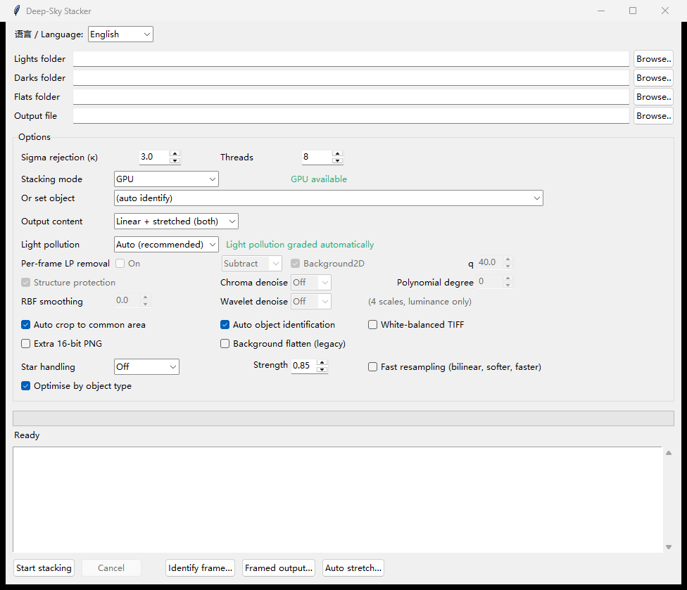

---

## Features

| Area | What it does |
|---|---|
| Input | Sony ARW, plus DNG / CR2 / NEF (via LibRaw); lights, darks, flats |
| Calibration | Master dark (4σ clipped mean); master flat normalised per CFA plane |
| Registration | Star detection + triangle-invariant matching + similarity transform (shift / rotation / scale) |
| Stacking | Two-pass κσ rejection, single-pass online rejection, GPU (CuPy, hand-written Catmull-Rom) |
| Stack quality | Per-frame weights from star count / noise / sharpness by default; `--ln` adds per-frame local normalisation for thin cloud and transparency swings |
| Colour calibration | `--color-cal` neutralises the background per channel; aimed at the linear TIFF people keep for their own post-processing |
| Light pollution | Per-frame LP removal, Background2D (mesh + structure protection), polynomial, RBF |
| Denoising | Luminance: à trous wavelet; chroma: wavelet chroma denoise (both light/medium/strong) |
| Star handling | Star reduction / removal built into the stacking run (`--star-mode`), plus auto-stretch and framed output |
| Object ID | Built-in Hipparcos blind solve, narrow (4°–8°) and medium (10°–30°) databases, 278-object catalogue |
| Smart mode | Grades light pollution (low/mid/high) and applies a preset; refines parameters by object type |
| Output | Linear 16-bit TIFF (opens in PS), stretched version, 16-bit PNG, framed image; JPGs are downscaled in float then dithered |

---

## Repository layout

```
deep-sky-stacker/
├─ src/
│   └─ astro_stack_gui.py      main program (GUI + CLI, single file)
├─ tools/
│   ├─ build_objects.py        builds data/objects.json from OpenNGC
│   └─ build_db_narrow.py      generates the narrow-field star database
├─ data/
│   ├─ objects.json            278 deep-sky objects (CC BY-SA 4.0)
│   └─ README.md               where the star databases come from
├─ docs/
│   ├─ 使用说明.txt             full manual (Chinese)
│   ├─ manual.en.md            full manual (English)
│   ├─ README.txt              quick reference for the packaged app
│   └─ images/                 screenshots and comparison images
├─ LICENSES/                   third-party licence texts
├─ .github/                    issue templates + CI
├─ requirements.txt
├─ LICENSE                     MIT
├─ NOTICE.md                   licences for data and images
├─ THIRD_PARTY_NOTICES.md      third-party components
└─ CONTRIBUTING.md / CODE_OF_CONDUCT.md / SECURITY.md / CHANGELOG.md / CITATION.cff
```

---

## Performance

Measured on 24 MP frames (3976×5976):

| Operation | Before | Now | What changed |
|---|---|---|---|
| Background2D + structure protection (per channel) | 16.4 s | **5.2 s** | vectorised block percentiles, two-stage upsampling, downsampled blur |
| Background2D mesh (per channel) | 2.0 s | **0.6 s** | same |
| Star mask (star removal) | 11.9 s | **3.5 s** | local MAD computed at reduced resolution |
| Star matching (per frame) | 166 ms | **95 ms** | reference frame triangle keys computed once |
| Single-pass stack (100 frames) | 164 s | **153 s** | mean/σ refreshed every 8 frames |

Optional: `--fast-warp` switches to bilinear resampling (14% faster on 60 frames,
slightly softer stars).

End to end (20 frames with darks and flats): **81 s → 58 s**; mean per-pixel difference
versus the pre-optimisation build is 0.94 ADU (sky is around 492 ADU), noise σ matches
to three decimals.

Full 1050-frame run (300 darks, 50 flats, auto grading and object ID): **12.0 minutes**.

---

## Examples

> All images below come from the same dataset: Sony a6400 + Tamron 18-300@300 mm,
> ISO 6400, 0.625 s subs of the Orion region (**1050 lights + 300 darks + 50 flats**).
> Sections 1/2/6/7 use all 1050 frames; sections 3/4 use an urban Milky Way set
> (ISO 400, 500 frames); section 5 uses the first 20 frames for a noise comparison.

### 1. Result: Orion Nebula (M42, all 1050 frames)

1050 lights + 300 darks + 50 flats, GPU single-pass stacking, **12.0 minutes** including
auto object identification and type-based tuning.
The program identifies M42 → applies the nebula preset → Background2D → auto stretch.

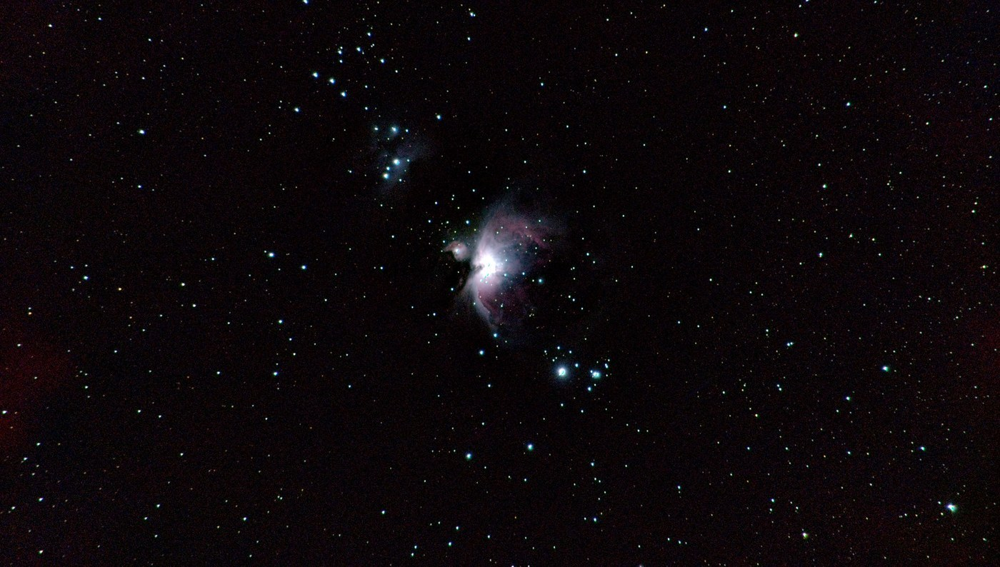

### 2. What dark and flat calibration does (60 frames)

Left: plain stacking, amp glow and vignetting blur the centre. Right: with 300 darks and
50 flats, the background plane drops from **294 ADU to 63 ADU**.

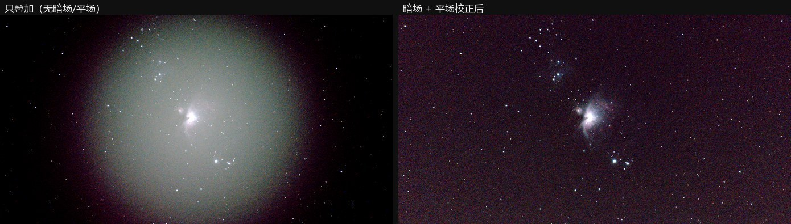

### 3. Light pollution removal (urban Milky Way, all 500 frames)

Shot in a Bortle 9 area. Left: raw stack, the light-pollution dome fills most of the frame.
Right: the program grades it as high, removes LP per frame, then Background2D(q=30) plus
structure protection and wavelet denoising (6.8 minutes). Background plane drops from
**7657 ADU to 60 ADU**.

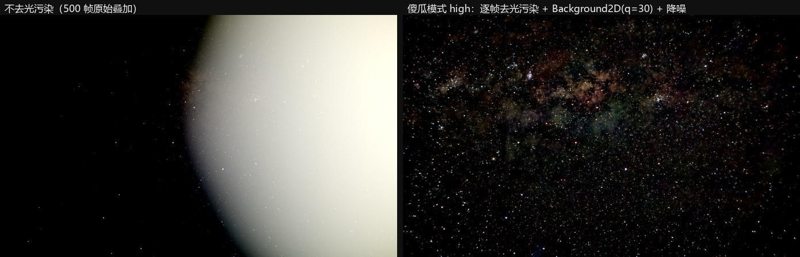

### 4. Chroma noise removal (`--chroma-denoise`)

Chroma only, luminance untouched: RGB → Y + (R-Y, G-Y, B-Y), wavelet denoise on the three
colour-difference planes, then recombine. Top row is a 1:1 crop (chroma σ 14.05 → 8.88 → 7.53),
bottom row is the full frame.

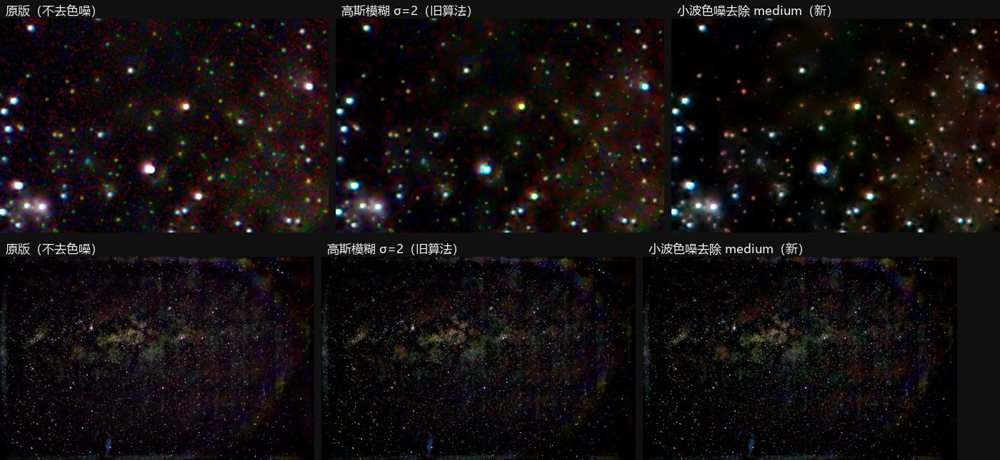

### 5. Wavelet denoising (`--denoise`)

À trous (starlet) multi-scale denoise: noise coefficients are soft-thresholded, stars
(large coefficients) are kept. Same 20 frames, only the strength changes
(background σ 21.5 → 8.2 → 6.7).

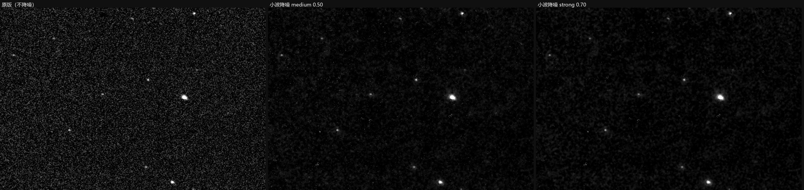

### 6. Star reduction (all 1050 frames, strength 0.80)

Halos are pushed toward the estimated background, stars get smaller and cleaner.
The main `<time>.tif` keeps the original stars; the reduced version is saved separately.

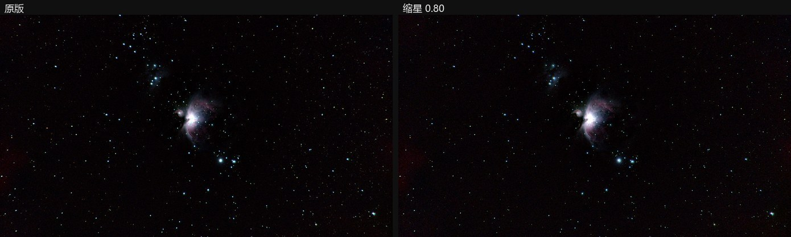

### 7. Star removal (all 1050 frames, strength 1.00)

Also writes a starless version and a star layer you can screen back in Photoshop.
More frames means cleaner removal: the residual peak of the 80 brightest stars is **1%**
(12% with only 20 frames). Mask coverage 2.45%, runtime about 30 seconds.

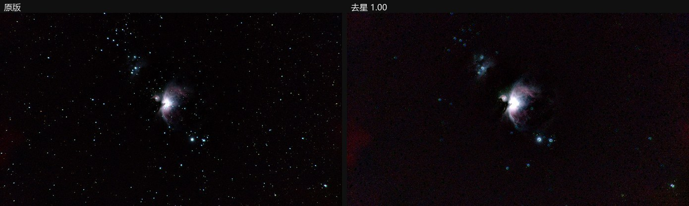

### 8. Auto stretch

Stacking outputs linear data — that is what Photoshop shows you on the left (nearly black).
On the right is the one-click stretch (white balance → lift → per-channel background removal
→ asinh → saturation).

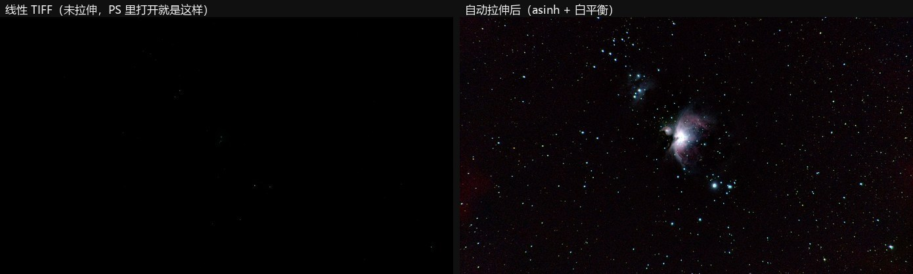

### 9. Resampling: cubic vs fast bilinear (`--fast-warp`)

Same 60 frames, same alignment, only the interpolation changes. Bilinear is 14% faster and
slightly softer on stars.

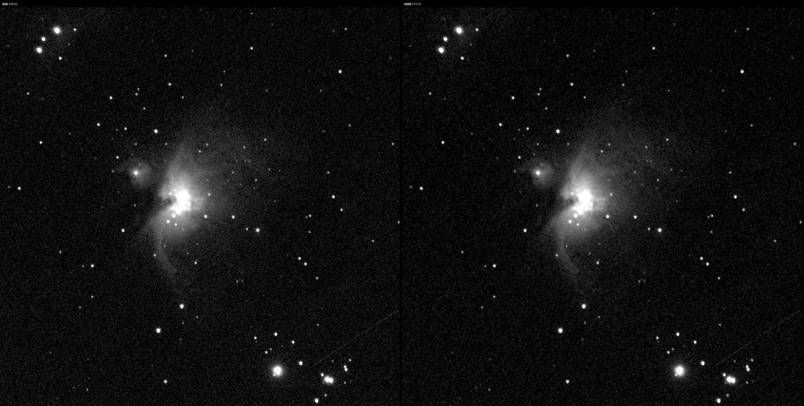

### 10. Framed output

The 1050-frame result above, with a white border and the object name in black. The name is
detected automatically.

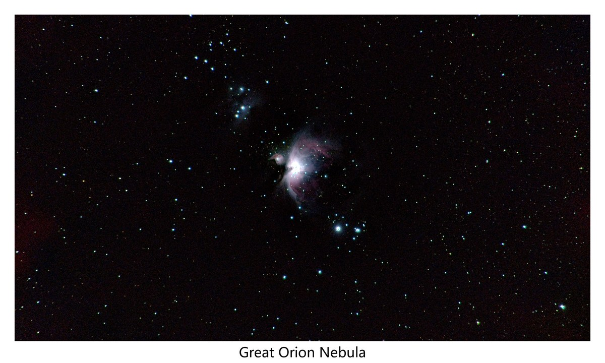

### 11. Plate solving

Blind solve against the built-in Hipparcos database; the result is also written to
`<time>_object.txt`:

```
Object   : M42 Orion Nebula (Great Orion Nebula)
Centre   : RA 05h35m16.9s  Dec -05°30'32.0"
Field    : 3.76° x 2.50° (diagonal 4.51°)
Matches  : 13, rotation 38.9°
Also in field: NGC1980, NGC1981, M43, NGC1977
```

---

## Install

### Option 1: grab the prebuilt exe (no Python needed)

From the [Releases](https://github.com/MRZH-shion/deep-sky-stacker/releases) page:

| File | What it is | Best for |
|---|---|---|
| `DeepSkyStacker-onedir.zip` | GUI, unzip and run `DeepSkyStacker.exe` | **recommended**: fast start, `raw_r.dll` visible and replaceable |
| `DeepSkyStacker_CLI-onedir.zip` | CLI, unzip and run `DeepSkyStacker_CLI.exe` | batch runs, folder is fine |
| `DeepSkyStacker.exe` | GUI, single file | you just want one exe to copy around |
| `DeepSkyStacker_CLI.exe` | CLI, single file | calling from scripts |
| `dsso_narrow.npz` | narrow-field star database (optional, ~35 MB, next to the exe) | object identification |

All four forms are the same build; only packaging differs. The zip versions start faster,
the single-file versions extract to a temp folder on every launch. **GPU users**: copy
`gpu_runtime/` next to the exe (or into the unzipped `DeepSkyStacker/` folder), otherwise it
falls back to CPU stacking.

Unzip into an **ASCII-only path** (CUDA's runtime compiler fails on non-ASCII paths) and drop
the star database next to the exe if you want identification. Nothing to install; deleting the
folder is the uninstall.

Chose onedir over onefile: faster startup (no 100+ MB extraction to a temp folder on every
launch) and `raw_r.dll` sits visibly in `_internal\`, which makes the LibRaw LGPL obligation
easier to satisfy.

The interface language switches in the dropdown at the top of the window (Chinese / English);
on the command line use `--lang zh|en`.

GPU mode needs an extra `gpu_runtime/` folder (CuPy + CUDA runtime), see `docs/README.txt`.
Without it the program stacks on the CPU with full functionality.

### Option 2: run from source

```bash
git clone https://github.com/MRZH-shion/deep-sky-stacker.git
cd deep-sky-stacker
pip install -r requirements.txt
pip install git+https://github.com/esa/tetra3@master
```

`tetra3` (blind plate solving) is not on PyPI, so it needs its own line.
If you have no git, install from the tarball instead:
`pip install https://github.com/esa/tetra3/archive/refs/heads/master.tar.gz`

**Star database.** Only one file is needed: download `dsso_narrow.npz` (4°–8°, ~35 MB)
from the Release page and put it in `data/`. The 10°–30° medium-field database ships with
tetra3 and is found automatically. Without any database the program still stacks fine; it
just reports the object as unknown.

Run from source:

```bash
python src/astro_stack_gui.py                 # GUI
python src/astro_stack_gui.py --cli --lights "D:\photos\light" \
    --darks "D:\photos\dark" --flats "D:\photos\flat" --out out.tif
```

---

## Usage

The GUI is three steps: pick the lights folder, pick darks and flats, press Start.
Defaults in the options panel suit most situations.

**Language**: the dropdown at the top of the window switches Chinese and English live; the
choice is stored in `settings.json` and reused next launch. On the command line use
`--lang zh|en`, which switches both the log output and `--help`.

Common command lines:

```bash
# Normal stack (auto light-pollution grading and object identification)
python src/astro_stack_gui.py --cli --lights "D:\photos\light" --darks "D:\photos\dark" --flats "D:\photos\flat" \
    --lp-level auto --out out.tif

# Urban Milky Way (heavy light pollution)
python src/astro_stack_gui.py --cli --lights "D:\photos\mw" --lp-level auto

# Star reduction during stacking
python src/astro_stack_gui.py --cli --lights "D:\photos\x" --star-mode reduce --star-strength 0.8

# Star removal (writes a starless version and a star layer)
python src/astro_stack_gui.py --cli --lights "D:\photos\x" --star-mode remove
```

Every parameter is documented in [`docs/manual.en.md`](docs/manual.en.md) (Chinese version:
[`docs/使用说明.txt`](docs/使用说明.txt)).

### When to use these switches

- **Quality weighting** (on by default): useful when a batch mixes thin-cloud or defocused
  frames — weak frames are pushed down to a quarter weight. On uniform data the result barely
  changes (background σ 10.750 → 10.748 measured).
- **Local normalisation** (`--ln`, off by default): for noticeably varying transparency. It
  samples only the central 70%, clamps gain to 1±8% and skips changes under 1%; on uniform data
  it costs 0.3–2.4% noise, which is why it stays off.
- **Colour calibration** (`--color-cal`, off by default): affects only the linear TIFF — the
  preview subtracts the background per channel, so it looks unchanged there. Meant for people
  who continue in PixInsight / PS; measured background G/R dropped from 1.12 to 1.01.

---

## Building an exe

```bash
pip install pyinstaller
pyinstaller --onefile --windowed --name DeepSkyStacker \
    --add-data "data/objects.json;." \
    --collect-all rawpy --collect-all tifffile \
    --hidden-import scipy.ndimage --hidden-import tetra3 \
    src/astro_stack_gui.py
```

GPU mode needs an extra `gpu_runtime/` folder (CuPy + CUDA runtime); it is not in the repo.
See `docs/README.txt` for how to assemble it.

---

## Licence

| Content | Licence |
|---|---|
| Source (`src/`, `tools/`) and documentation text | **MIT** (see `LICENSE`) |
| `data/objects.json` | **CC BY-SA 4.0** (derived from OpenNGC, see `NOTICE.md`) |
| Star databases | generated with tetra3 (Apache-2.0) from the Hipparcos catalogue (ESA) |
| Example images (`docs/images/`) | taken by the author, **CC BY-NC 4.0** (attribution, **no commercial use**) |
| Third-party libraries | see `THIRD_PARTY_NOTICES.md` and `LICENSES/` |

`LICENSE` contains the MIT text only; the boundaries between components are described in
[`LICENSES/README.md`](LICENSES/README.md).

Contributions: [`CONTRIBUTING.md`](CONTRIBUTING.md) · conduct:
[`CODE_OF_CONDUCT.md`](CODE_OF_CONDUCT.md) · security: [`SECURITY.md`](SECURITY.md) ·
changes: [`CHANGELOG.md`](CHANGELOG.md).

**Note:** the repo does not contain NVIDIA's CUDA runtime (proprietary licence, cannot be
redistributed separately). For GPU mode install it yourself: `pip install cupy-cuda12x`.

---

## Known limitations

- Plate solving covers fields between **4° and 30°** diagonal; narrower or wider fields need
  the manual object setting
- Star removal is a classical algorithm (no AI); very bright stars with large halos may leave
  a faint core
- Dense fields such as wide Milky Way frames are better served by star *reduction* than removal
- Untracked exposures of 4 s or more produce trailed stars; that is a capture problem, stacking
  cannot fix it

---

## Acknowledgements

- [tetra3](https://github.com/esa/tetra3) (ESA, Apache-2.0) — blind plate solving
- [OpenNGC](https://github.com/mattiaverga/OpenNGC) (CC BY-SA 4.0) — deep-sky catalogue
- [rawpy](https://github.com/letmaik/rawpy) / [LibRaw](https://www.libraw.org/) — RAW decoding
- NumPy, SciPy, Pillow, tifffile
- The à trous wavelet denoise follows Starck & Murtagh's decomposition; the implementation is ours
