# 深空堆栈工具（Deep-Sky Stacker）

**语言：中文 | [English](README.en.md)**

把一批 RAW 帧对齐、剔除、叠加成一张深空照片的 Windows 工具。
Python 写的，有图形界面也能命令行跑，可以打包成单文件 exe。

支持一次处理 1000 帧以上的批次：GPU 单遍叠加、自动判断光害等级、自动识别目标。

---

## 界面

图形界面只有四个路径框和一组选项，光害处理和参数大多可以交给自动判断。

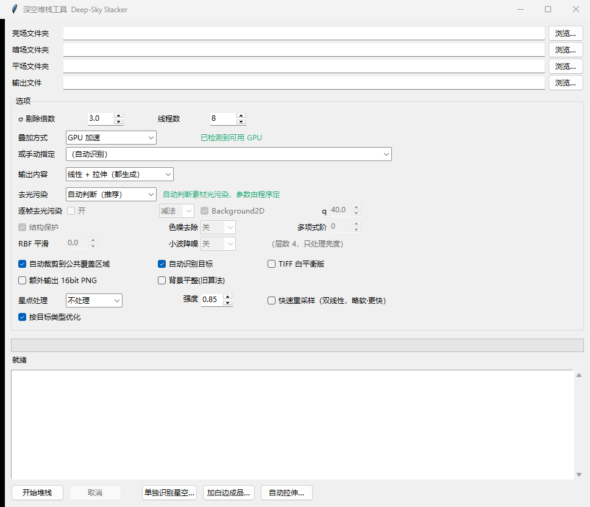

---

## 功能一览

| 模块 | 能力 |
|---|---|
| 输入 | Sony ARW，也支持 DNG / CR2 / NEF（走 LibRaw）；亮场 / 暗场 / 平场 |
| 校准 | 主暗场 4σ 裁剪平均；主平场按 CFA 四个通道分别归一 |
| 配准 | 星点检测 + 三角不变量匹配 + 相似变换（平移 / 旋转 / 缩放） |
| 叠加 | 两遍 κσ 剔除、单遍在线剔除、GPU（CuPy，手写 Catmull-Rom） |
| 叠加质量 | 默认按星点数 / 噪声 / 锐度给每帧加权，并做逐帧局部归一化（`--no-ln` 可关）；内存不足时自动降线程 |
| 色彩校准 | `--color-cal` 按背景分位数把三通道拉成中性灰，主要给要自己后期的线性 TIFF |
| 去光污染 | 逐帧去光污染、Background2D（网格+结构保护）、多项式、RBF |
| 降噪 | 亮度：à trous 小波降噪；色度：小波色噪去除（都分轻/中/强） |
| 星点处理 | 缩星 / 去星已并入叠加流程（`--star-mode`），另有自动拉伸、加白边成品 |
| 目标识别 | 内置 Hipparcos 星表盲解，窄视场（4°–8°）+ 中视场（10°–30°）双库，278 个天体目录 |
| 傻瓜模式 | 自动判断光害等级（低/中/高）并按预设套参数；识别目标后按类型微调 |
| 输出 | 线性 16bit TIFF（可直接进 PS）、拉伸版、16bit PNG、白边成品图；JPG 用浮点超采样（先缩放后量化 + 抖动） |

---

## 目录结构

```
deep-sky-stacker/
├─ src/
│   └─ astro_stack_gui.py      主程序（图形界面 + 命令行，单文件）
├─ tests/
│   ├─ run_tests.py            测试入口（单元 + 可选端到端）
│   └─ test_units.py           纯函数与数值流程的单元测试
├─ tools/
│   ├─ build_objects.py        从 OpenNGC 生成 data/objects.json
│   └─ build_db_narrow.py      生成窄视场星表库
├─ data/
│   ├─ objects.json            278 个深空天体（CC BY-SA 4.0）
│   ├─ dsso_database.npz       中视场星表库（10°–30°）
│   ├─ dsso_narrow.npz         窄视场星表库（4°–8°）
│   └─ README.md               数据来源与许可是谁
├─ docs/
│   ├─ 使用说明.txt             每个参数影响什么（详细）
│   ├─ manual.en.md            同一份手册的英文版
│   ├─ README.txt              参数速查与实测数据
│   └─ images/                 README 用的功能例图（10 张）
├─ LICENSES/                   第三方许可全文（12 个）
├─ .github/                    Issue 模板 + CI
├─ requirements.txt
├─ LICENSE                     MIT
├─ NOTICE.md                   数据与图片的许可
├─ THIRD_PARTY_NOTICES.md      第三方组件声明
├─ CONTRIBUTING.md / CODE_OF_CONDUCT.md / SECURITY.md / CHANGELOG.md
└─ CITATION.cff
```

---


运行测试：

```bash
python tests/run_tests.py

# 想加跑 8 帧真实素材的端到端回归
set STACKER_TEST_LIGHTS=D:\photos\light   # Windows
python tests/run_tests.py
```

## 性能

在 2000 万像素级别（3976x5976）的实测开销：

| 操作 | 优化前 | 优化后 | 做法 |
|---|---|---|---|
| Background2D + 结构保护（每通道） | 16.4 s | **5.2 s** | 分块分位数向量化 + 两段式上采样 + 降采样高斯 |
| Background2D 网格（每通道） | 2.0 s | **0.6 s** | 同上 |
| 去星掩膜（star_mask） | 11.9 s | **3.5 s** | 局部 MAD 图降采样后再算 |
| 星点匹配（每帧） | 166 ms | **~95 ms** | 参考帧三角键只算一次 |
| 单遍叠加（100 帧） | 164 s | **153 s** | 均值/σ 每 8 帧刷新一次 |

可选加速：`--fast-warp`（双线性重采样，60 帧实测快 14%，星点略软）。

整体（20 帧含暗场平场）：**81 s -> 58 s（-28%）**；输出与优化前逐像素平均差 0.94 ADU
（背景约 492 ADU），噪声 σ 一致到小数点后三位。

1050 帧全量（含 300 暗场 + 50 平场 + 自动识别 + 类型优化）：**12.0 分钟**。

---

## 效果示例

> 下面所有图都来自同一套素材：Sony a6400 + Tamron 18-300@300mm、ISO 6400、0.625s 的猎户座星云数据
> （**1050 张亮场 + 300 暗场 + 50 平场**）。
> 第 1/2/6/7 节用 1050 帧全量，第 3/4 节换成城市里拍的 ISO400 银河（500 帧全量），第 5 节用前 20 帧做噪点对比。

### 1. 成品：猎户座大星云（M42，1050 帧全量）

1050 亮场 + 300 暗场 + 50 平场，GPU 单遍叠加，**12.0 分钟**出图（含自动识别与类型优化）。
自动识别目标（M42 猎户座大星云）→ 按星云类型优化参数 → Background2D 去背景 → 自动拉伸。

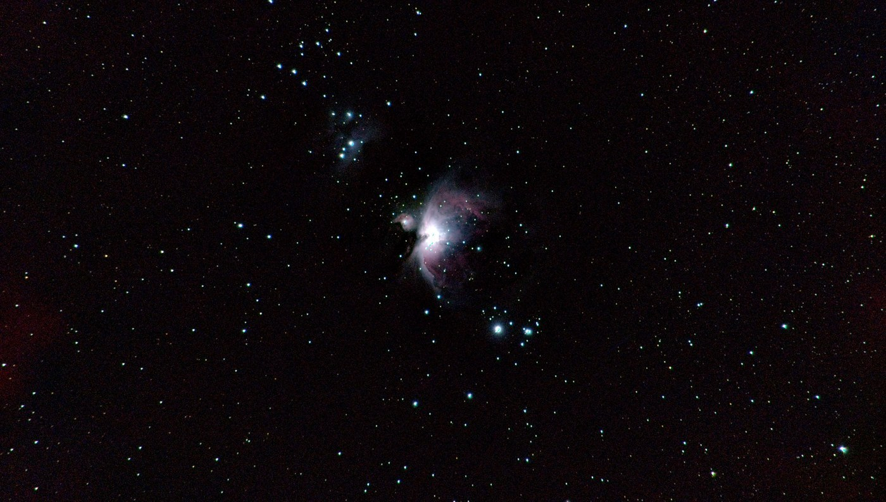

### 2. 暗场 + 平场校正（同一素材，60 帧）

左：只叠加、不做校准，放大器辉光 + 渐晕把画面中心糊成一大团；右：加上 300 暗场 + 50 平场后，
背景面起伏从 **294 ADU 降到 63 ADU**，星云和星点都干净了。

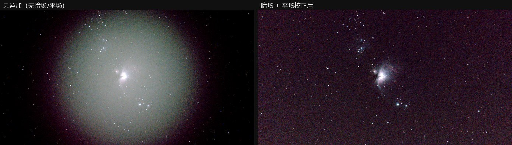

> 强光害素材（城市银河）还需要额外开 `--lp` / `--lp-level auto` 做逐帧去光污染，
> 那是另一条链路，这里单帧天空本身就比较平，用不上。

### 3. 去光污染（强光害素材：ISO400 银河，500 帧全量）

这一节素材换成城市里拍的银河（Bortle 9 级别），因为它才是"去光污染"真正要对付的场面。
左：500 帧原始叠加，光害穹顶几乎压满画面；右：傻瓜模式自动判定 `high`，
逐帧去光污染 + Background2D(q=30) + 结构保护 + 小波降噪 0.45 + 小波色噪去除 0.55（6.8 分钟）。
背景面起伏从 **7657 ADU 降到 60 ADU**，银河与暗尘带才露出来。

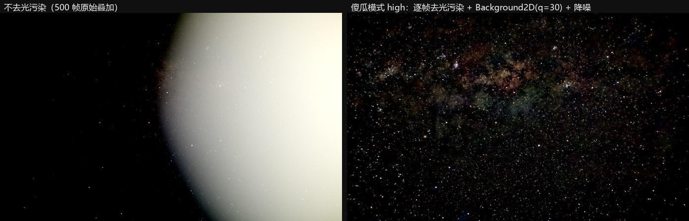

### 4. 色噪去除（`--chroma-denoise`）

只处理色度、不动亮度：RGB → Y + (R-Y, G-Y, B-Y)，对三个色差平面做小波降噪再合成。
强光害 + 少帧的素材色噪最凶。下图上排是 1:1 裁切（色噪 σ 14.05 → 8.88 → 7.53），
下排是全图预览，可以看到整体观感：

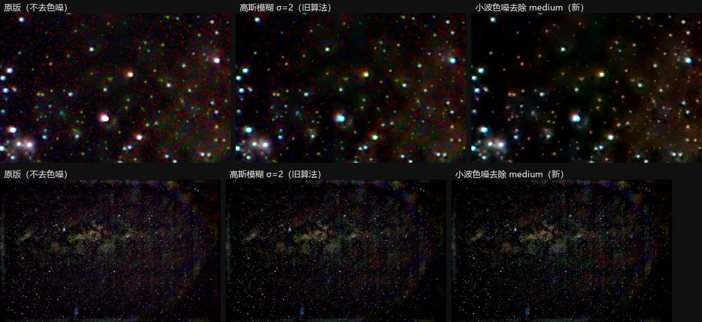

### 5. 小波降噪（`--denoise`）

à trous(starlet) 多尺度去噪：噪声层被软阈值压掉，星点（大系数）保留。
同一素材取 20 帧、同样参数，只改降噪档位的灰度对比（背景噪声 σ 21.5 → 8.2 → 6.7）：

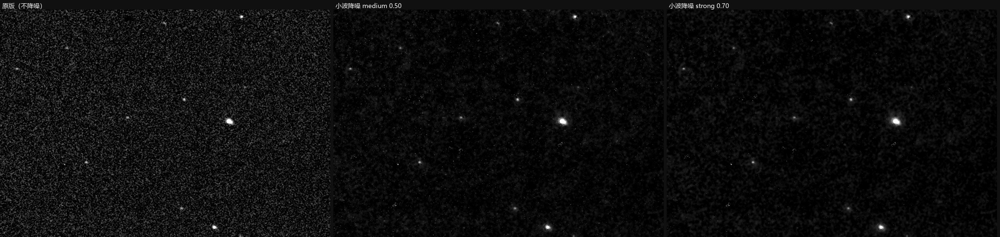

### 6. 缩星（1050 帧全量，强度 0.80）

1050 帧全量成品：星点变小变干净，主体星云更突出；主成品 `<时刻>.tif` 仍保留原版，
缩星版另存为 `_starred.tif`。

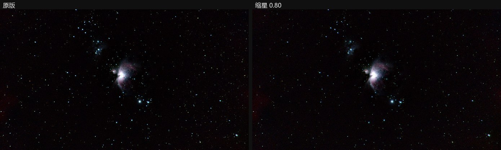

### 7. 去星（1050 帧全量，强度 1.00）

1050 帧全量成品：额外输出无星版 + 星点层，方便在 PS 里把星点层用"滤色"叠回去做星云强化。
帧数越足去星越干净——实测 80 颗亮星的残余峰值中位仅 **1%**（20 帧时是 12%），
掩膜覆盖 2.45%，全程约 30 秒。

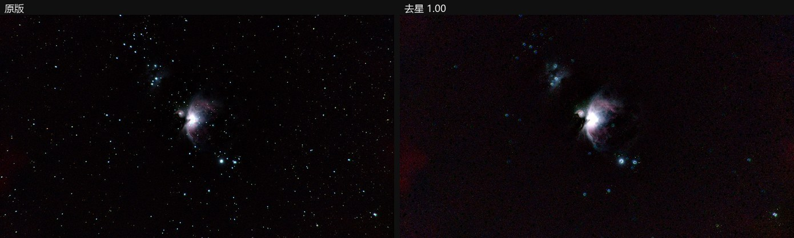

### 8. 自动拉伸

堆栈输出的是线性数据，PS 里打开就是左边这样（全黑）；右侧是同一张图一键拉伸的效果
（白平衡 → 提亮 → 逐通道扣背景 → asinh → 饱和度）。

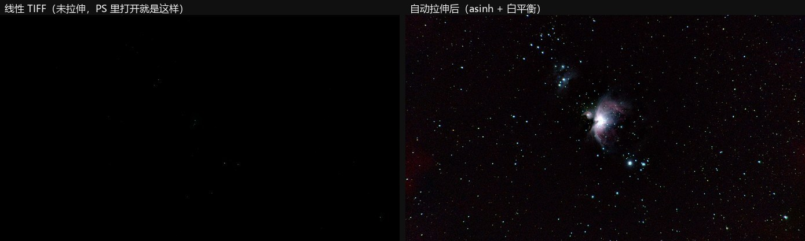

### 9. 重采样：三次插值 vs 快速双线性（`--fast-warp`）

同一素材 60 帧、同一份对齐参数，只换重采样方式。双线性快 14%，代价是星点略软。

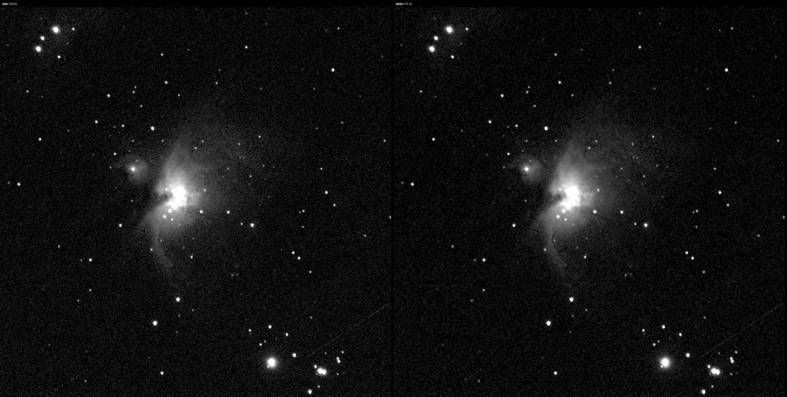

### 10. 加白边成品

用第 1 节那张 1050 帧成品直接出图：自动识别出目标名，白底黑字，不用手动输入。

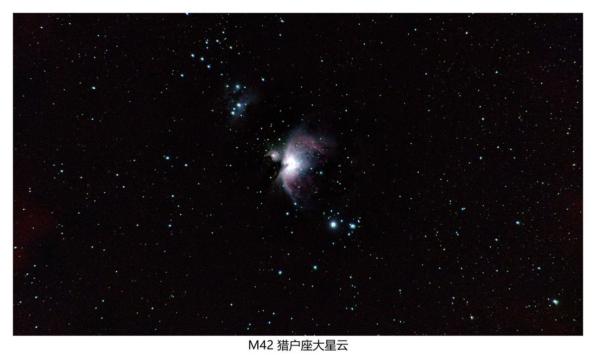

### 11. 星场识别

用内置 Hipparcos 星表盲解，识别结果同时写入 `<时刻>_object.txt`：

```
识别结果: M42 猎户座大星云 (Great Orion Nebula)
星场中心: RA 05h35m16.9s  Dec -05°30'32.0"
视场: 3.76° x 2.50° (对角 4.51°)
匹配星数: 13, 旋转: 38.9°
视场内其它目标: NGC1980, NGC1981, M43, NGC1977
```

---

## 安装

### 方式一：直接用打好的 exe（不用装 Python）

到 [Releases](https://github.com/MRZH-shion/deep-sky-stacker/releases) 页面下载：

| 文件 | 用途 | 适合谁 |
|---|---|---|
| `DeepSkyStacker-onedir.zip` | 图形界面版，解压后双击 `DeepSkyStacker.exe` | **推荐**：启动快，`raw_r.dll` 可直接查看/替换 |
| `DeepSkyStacker_CLI-onedir.zip` | 命令行版，解压后用 `DeepSkyStacker_CLI.exe` | 需要批量跑、又不介意文件夹 |
| `DeepSkyStacker.exe` | 图形界面单文件版 | 只想拷一个 exe 走 |
| `DeepSkyStacker_CLI.exe` | 命令行单文件版 | 脚本里调用，单文件最省事 |
| `dsso_narrow.npz` | 窄视场星表（可选，放 exe 同目录才能识别目标，约 35 MB） | 想用目标识别 |

四种形态功能完全一致，只是打包方式不同：zip 版解压即用、启动快；单文件版是 exe，
每次启动会先解压到临时目录。**GPU 用户注意**：要把 `gpu_runtime/` 复制到 exe（或解压后的
`DeepSkyStacker/`）同目录，否则会走 CPU 叠加。

解压到**全英文路径**的目录（路径含中文时 CUDA 运行时编译会失败），星表放 exe 同目录。
不需要安装，删掉文件夹就是卸载。

用 onedir 而不是单文件：启动快（不用每次解压 100 多 MB 到临时目录），
`raw_r.dll` 也明摆着放在 `_internal\` 里，LibRaw 的 LGPL 要求更好满足。

界面语言在窗口顶部下拉框切，中英都有；命令行加 `--lang zh|en`。

GPU 模式需要额外准备 `gpu_runtime/` 目录（CuPy + CUDA 运行库），见 `docs/README.txt`；
没有这个目录时自动用 CPU 叠加，功能不缺。

### 方式二：从源码跑

```bash
git clone https://github.com/MRZH-shion/deep-sky-stacker.git
cd deep-sky-stacker
pip install -r requirements.txt
pip install git+https://github.com/esa/tetra3@master
```

`tetra3`（星场盲解）没有发布到 PyPI，必须从源码装，所以单独一行。

**星表**只需要一个文件：到 Release 页面下载 `dsso_narrow.npz`（4°–8° 窄视场，约 35 MB）
放进 `data/`。10°–30° 的中视场库用 tetra3 自带的那份，程序会自动找到，不用另外下。
两个都没有也能堆栈，只是识别目标会显示"未知"。

直接跑源码：

```bash
python src/astro_stack_gui.py                 # 图形界面
python src/astro_stack_gui.py --cli --lights "D:\photos\light" \
    --darks "D:\photos\dark" --flats "D:\photos\flat" --out out.tif
```

## 使用

界面只有三步：选亮场、选暗场平场、点开始堆栈。选项区的默认值适合大多数情况。

**界面语言**：窗口顶部有「语言 / Language」下拉框，中英即时切换，选择记在
`settings.json` 里，下次启动沿用。命令行用 `--lang zh|en`，日志和 `--help` 一起切换。

**线程数**：默认 `0`（自动），按图片尺寸和可用内存决定。一个 6000×4000 的叠加线程约
0.45 GB，程序会把线程数压到内存预算（默认可用内存的 55%）以内，避免小内存机器被撑爆。
命令行可用 `--threads N` 固定、`--mem-gb G` 改预算。

命令行常用：

```bash
# 常规堆栈（自动判断光害等级、自动识别目标）
python src/astro_stack_gui.py --cli --lights "D:\photos\light" --darks "D:\photos\dark" --flats "D:\photos\flat" \
    --lp-level auto --out out.tif

# 城市银河（强光害）
python src/astro_stack_gui.py --cli --lights "D:\photos\mw" --lp-level auto

# 叠加时顺带缩星
python src/astro_stack_gui.py --cli --lights "D:\photos\x" --star-mode reduce --star-strength 0.8

# 叠加时去星（额外输出无星版 + 星点层）
python src/astro_stack_gui.py --cli --lights "D:\photos\x" --star-mode remove
```

完整参数说明见 [`docs/使用说明.txt`](docs/使用说明.txt)。

### 什么时候用这几个开关

- **质量加权**（默认开）：一批里混了薄云帧、跑焦帧时有用，坏帧会被压到 0.25 倍权重；
  素材本身均匀时结果几乎不变（实测背景噪声 σ 10.750 → 10.748）。
- **局部归一化**（默认开，`--no-ln` 关）：把每帧的增益/偏移拉回参考帧，抑制透明度差异
  带来的背景不平。只在中部 70% 取样（避开重采样边缘填充），增益限幅 1±8%，变化小于 1%
  直接跳过。实测 300 帧：背景噪声 σ 11.249 → 10.989（−2.3%），耗时 +2.7%。
- **色彩校准**（`--color-cal`，默认关）：只影响输出的线性 TIFF，预览图会自动扣背景，
  所以看不出差别。适合拿去 PixInsight / PS 继续做的人；实测背景 G/R 从 1.12 降到 1.01。

---

## 打包 exe

```bash
pip install pyinstaller
pyinstaller --onefile --windowed --name DeepSkyStacker \
    --add-data "data/objects.json;." \
    --collect-all rawpy --collect-all tifffile \
    --hidden-import scipy.ndimage --hidden-import tetra3 \
    src/astro_stack_gui.py
```

GPU 模式需要额外的 `gpu_runtime/`（CuPy + CUDA 运行库），仓库不含，准备方法见 `docs/README.txt`。

---

## 许可

| 内容 | 许可 |
|---|---|
| 源代码 (`src/`, `tools/`) 与文档文字 | **MIT**（见 `LICENSE`） |
| `data/objects.json` | **CC BY-SA 4.0**（OpenNGC 衍生，见 `NOTICE.md`） |
| `data/dsso_*.npz` | tetra3 (Apache-2.0) + Hipparcos (ESA) 生成 |
| 示例图（`docs/images/`） | 作者本人拍摄，**CC BY-NC 4.0**（署名，**禁止商用**） |
| 第三方库 | 见 `THIRD_PARTY_NOTICES.md` 与 `LICENSES/` |

`LICENSE` 只放 MIT 正文，各部分的界限写在 [`LICENSES/README.md`](LICENSES/README.md)。

参与贡献请看 [`CONTRIBUTING.md`](CONTRIBUTING.md)，行为准则见 [`CODE_OF_CONDUCT.md`](CODE_OF_CONDUCT.md)，
安全策略见 [`SECURITY.md`](SECURITY.md)，版本变化见 [`CHANGELOG.md`](CHANGELOG.md)。

**注意**：本仓库**不包含** NVIDIA CUDA 运行库（专有许可，禁止单独再分发）。
示例图（`docs/images/`）采用 **CC BY-NC 4.0，禁止商业使用**；商用授权请单独联系作者。
需要 GPU 功能请自行 `pip install cupy-cuda12x`。

---

## 已知限制

- 星场识别只覆盖 **4°~30°** 对角视场；更窄/更宽的视场请用手动指定目标
- 去星是传统算法（非 AI），过曝带大光晕的亮星可能残留
- 密星场（银河广角）建议用"缩星"而不是"去星"

---

## 致谢

- [tetra3](https://github.com/esa/tetra3)（ESA，Apache-2.0）—— 星场盲解
- [OpenNGC](https://github.com/mattiaverga/OpenNGC)（CC BY-SA 4.0）—— 深空天体目录
- [rawpy](https://github.com/letmaik/rawpy) / [LibRaw](https://www.libraw.org/) —— RAW 解码
- NumPy、SciPy、Pillow、tifffile
- à trous 小波降噪参考 Starck & Murtagh 的分解方法，实现为本项目自行编写
